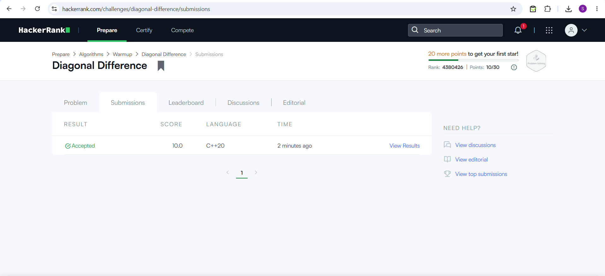
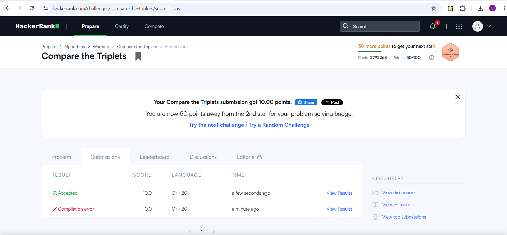
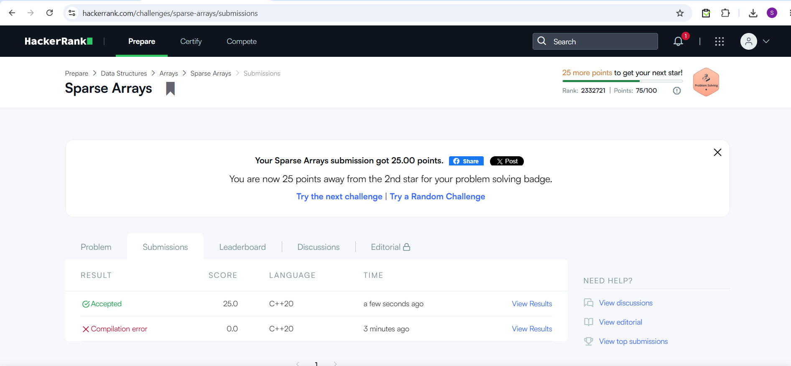

# HackerRank 3rd Semester Portfolio

Sayibanna Siddappa Dindawar | R25EF244

HackerRank profile: https://www.hackerrank.com/profile/sayabannadindaw1

All solutions are written in C++. Each problem has its own folder with a commented `solution.cpp` that also contains local test cases, plus a screenshot of the accepted submission.

## Complexity Summary

| # | Problem | Topic | Time | Space |
|---|---------|-------|------|-------|
| 1 | Diagonal Difference | 2D Arrays / Matrices | O(N) | O(1) |
| 2 | Dynamic Array | Data Structures / Vectors | O(N + Q) | O(N) |
| 3 | Time Conversion | Strings & Logic | O(1) | O(1) |
| 4 | Compare the Triplets | Basic Implementation | O(1) | O(1) |
| 5 | Sparse Arrays | Hash Maps / Strings | O(N + Q) | O(N) |

## Accepted Submissions

## HackerRank Badges

Problem Solving (3 stars) and C++ (3 stars).

